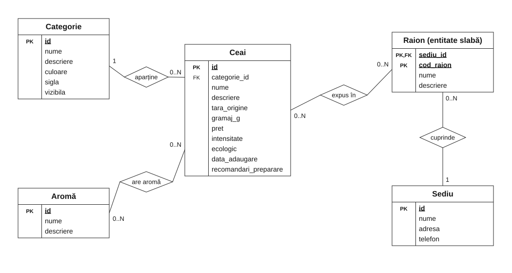
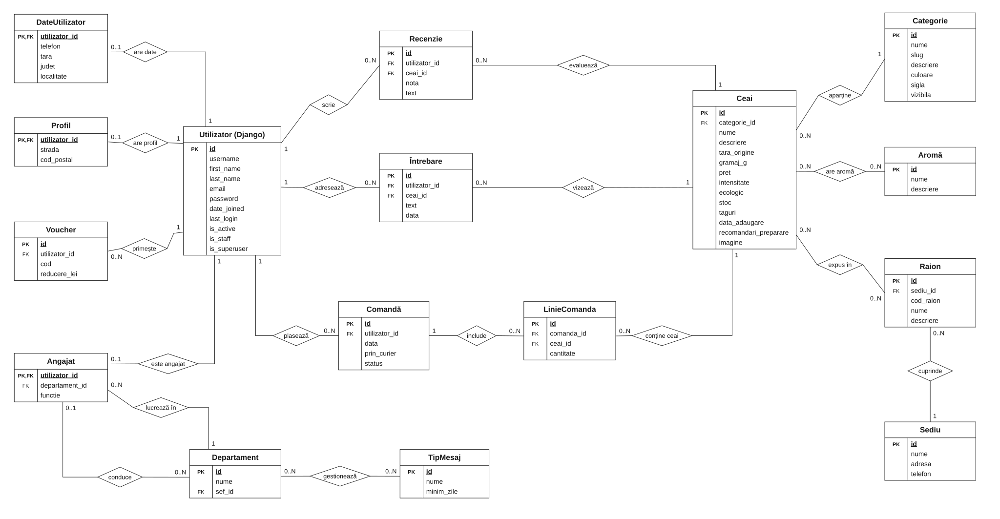

# Frunză de Ceai

Avătămăniţei Ionuţ Andrei · grupa 233

## Descrierea proiectului

Frunză de Ceai este un magazin online de ceaiuri vrac verzi, negre, albe și oolong. Vizitatorul poate compara pachetele după gramaj și preț, poate vedea aromele și recomandările de preparare sau poate trimite o întrebare magazinului. Site-ul este realizat în Django, cu o bază de date PostgreSQL.

## Paginile site-ului

| Pagină | Rută | Ce găsești aici |
| --- | --- | --- |
| Acasă | `/` | Prezentarea magazinului, sortimentele de ceai, sfaturi de preparare, programul și noutățile. |
| Despre | `/despre` | Povestea magazinului și valorile sale. |
| Istoric | `/istoric` | Cum a început proiectul, de la primele informații adunate despre ceaiuri. |
| Catalog | `/produse` | Ceaiurile pot fi filtrate după preț, origine, aromă sau stoc și sortate, de exemplu, după preț sau gramaj. |
| Categorie | `/categorii/<slug>` | Catalogul restrâns la o categorie. În adresă, `<slug>` este numele scurt al categoriei. |
| Detalii produs | `/produs/<id>` | Fișa unui ceai, cu prețul pachetului, gramajul, stocul, recomandările de preparare și ceaiuri similare. |
| Contact | `/contact` | Formular pentru întrebări, cereri, reclamații, programări sau recenzii. Vizitatorul alege tipul mesajului și departamentul destinatar. |
| Coș virtual | `/cos_virtual` | Afișează „În lucru”. Plasarea comenzilor prin site este încă în dezvoltare. |

### Contul clientului

| Acțiune | Rută | Cum funcționează |
| --- | --- | --- |
| Înregistrare | `/inregistrare` sau `/register` | Creezi un cont cu nume de utilizator, parolă, prenume, nume, e-mail și date de contact. |
| Autentificare | `/autentificare` sau `/login` | Intri în cont și ajungi la profil. „Ține-mă minte o zi” păstrează sesiunea 24 de ore. Cu opțiunea debifată, sesiunea expiră la închiderea browserului. |
| Profil | `/profil` | Vezi datele contului și adresa completată. Aplicația păstrează aceste date în sesiune. |
| Editare | `/profil/modifica`, `/profil/parola` | Primul formular actualizează datele personale și adresa. Al doilea schimbă parola. |
| Deconectare | `/deconectare` | Butonul din meniul utilizatorului autentificat închide sesiunea printr-o cerere POST. |

### Administrare și informații tehnice

| Rută | Rol |
| --- | --- |
| `/admin/` | Personalul autorizat administrează datele prin interfața Django. |
| `/produse/adauga` | Personalul adaugă un ceai. Formularul calculează prețul din cost și adaos. |
| `/mesaje` | Personalul consultă mesajele primite, după departament și dată. Atașamentele se deschid prin `/mesaje/<dep>/<dosar>/<nume>`. |
| `/info` | Data și ora serverului. `?data=zi` afișează data, iar `?data=timp` afișează ora. |
| `/log` | Jurnalul accesărilor și paginile cel mai des și cel mai rar vizitate. Acceptă `ultimele`, `iduri`, `dubluri`, `accesari` și `tabel`. De exemplu, `/log?ultimele=5` arată ultimele cinci accesări. |
| `/accesare<id>` | Detaliile unei vizite înregistrate. De exemplu, `/accesare7` afișează accesarea cu ID-ul 7. |
| `/test_mail` | Trimite un e-mail de probă către destinatarul configurat în aplicație. |

## Datele firmei

Paginile magazinului folosesc șablonul comun `baza.html`, cu meniu, conținut și subsol. Datele demonstrative provin din dicționarul `FIRMA` din `settings.py`. Frunză de Ceai apare ca magazin înființat în 2026, cu sediul pe Strada Ceaiului nr. 10, București. Programul este luni–vineri, 09:00–18:00. Telefonul este 0700 000 000, iar adresa de e-mail este `contact@frunzadeceai.ro`. Subsolul afișează și IP-ul vizitatorului, preluat de middleware.

## Diagrama entitate–relație a catalogului

Fiecare dreptunghi reprezintă o entitate, iar fiecare romb numește o relație. `PK` marchează cheia primară, iar `FK` o referință la alt tabel. La capătul unei legături, `1` înseamnă exact un element, `0..1` înseamnă cel mult unul, iar `0..N` înseamnă zero sau mai multe.

[Deschide imaginea la dimensiunea originală](documentatie/schema_catalog.svg) · [Editează în draw.io](documentatie/schema_catalog.drawio) · [Diagrama inițială](documentatie/diagrama_ceaiuri.png)

### Entități și relații

- **Ceai** descrie un pachet prin nume, origine, gramaj, preț, intensitate, stoc și recomandări de preparare. Fiecare ceai aparține unei singure **Categorii**, iar o categorie poate grupa mai multe ceaiuri.
- **Aromă** descrie gustul sau parfumul unui ceai. Un ceai poate avea mai multe arome, iar aceeași aromă poate apărea la mai multe ceaiuri.
- **Sediu** reprezintă un punct fizic al magazinului, cu adresă și telefon. Fiecare **Raion** aparține unui sediu. Un raion poate expune mai multe ceaiuri, iar același ceai poate fi expus în mai multe raioane.

**Raion** este entitatea slabă din schema conceptuală. De exemplu, două sedii pot avea fiecare un raion `R1`. Perechea `(sediu_id, cod_raion)` identifică raionul. În PostgreSQL, Django îi atribuie și un `id` și păstrează regula de unicitate pentru pereche.

## Utilizatori

[Deschide imaginea la dimensiunea originală](documentatie/schema_magazin.svg) · [Editează în draw.io](documentatie/schema_magazin.drawio)

| Entități | Ce păstrează și cum se leagă |
| --- | --- |
| **Utilizator**, **DateUtilizator**, **Profil** | Contul Django păstrează numele de utilizator, prenumele, numele, e-mailul și parola sub formă de hash. La înregistrare se cer telefonul, țara, județul și localitatea. Strada și codul poștal sunt opționale. Fiecare cont poate avea un singur profil, creat când utilizatorul completează cel puțin unul dintre cele două câmpuri. |
| **Comandă**, **LinieComanda** | Fiecare comandă are un cumpărător, data înregistrării, opțiunea de livrare prin curier și starea comenzii (nouă, expediată sau finalizată). O linie leagă comanda de un ceai și păstrează cantitatea. Trei pachete din același ceai apar pe o singură linie cu cantitatea 3. |
| **Angajat**, **Departament**, **TipMesaj** | Un angajat este legat de un singur cont și are o funcție și un departament. Departamentul poate avea un șef ales dintre angajați. Tipul mesajului stabilește termenul minim în zile și departamentele care îl pot primi. |
| **Recenzie**, **Întrebare**, **Voucher** | O recenzie leagă autorul de un ceai și păstrează o notă de la 1 la 5 și un text. O întrebare are autor, ceai, text și dată. Un voucher aparține unui utilizator și are un cod unic și o reducere în lei. |

### Tipuri de date și normalizare

Schema folosește texte pentru denumiri, numere întregi pentru cantități, zecimale pentru prețuri, date calendaristice cu oră și valori da/nu pentru câmpuri precum `ecologic`. Intensitatea ceaiului are trei valori posibile. Tagurile și recomandările de preparare pot conține mai multe valori.

În proiectarea pentru forma normală a treia, fiecare informație descrie entitatea căreia îi aparține. Adresa se păstrează la sediu, culoarea la categorie, iar numărul de pachete la linia comenzii. Tagurile și recomandările sunt păstrate ca liste, o excepție de la reprezentarea strict atomică a atributelor.
