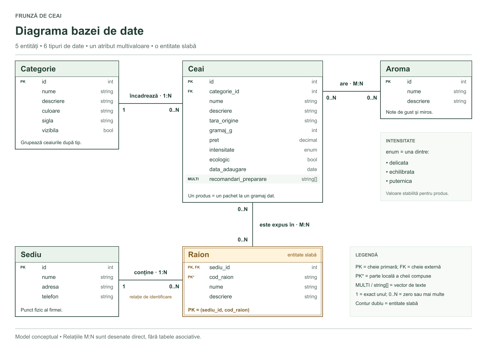

# Avătămăniţei Ionuţ Andrei 233

## Frunză de Ceai

Frunză de Ceai este un magazin online de ceaiuri. Proiectul va prezenta
ceaiuri verzi, negre, albe și oolong, cu informații despre origine, arome,
gramaj, preț și modul de preparare. Clienții vor putea consulta catalogul,
filtra produsele și, în etapele următoare, adăuga ceaiurile în coș și plasa comenzi.

## Conținut

| Pagină | Ce conține |
| --- | --- |
| `/` | Pagina principală, cu cinci secțiuni: prezentare, sortimente, preparare, program și noutăți. |
| `/despre` | Două secțiuni: povestea magazinului și valorile sale. |
| `/istoric` | Primii pași ai magazinului și ce urmează să adăugăm în proiect. |
| `/produse` | Catalogul de ceaiuri din baza de date. |
| `/produs/<id>` | Detaliile unui ceai; răspunde cu 404 dacă produsul nu există. |
| `/contact` | Pagina de contact; momentan afișează „In lucru”. |
| `/cos_virtual` | Coșul de cumpărături; momentan afișează „In lucru”. |
| `/info` | Data și ora serverului; parametrul `data=zi` afișează data, iar `data=timp` afișează ora. |
| `/log` | Cererile către paginile aplicației și filtrele descrise mai jos. |
| `/accesare7` | Toate informațiile despre accesarea cu ID-ul 7; numărul poate fi înlocuit cu alt ID. |
| `/admin/` | Administrarea modelelor, accesibilă după autentificarea cu un superuser. |

Meniul are submeniuri cu linkuri către pagini și către secțiunile paginii
principale. Pagina principală și pagina „Despre” au câte o imagine.

## Cum se leagă fișierele

Un **modul** este un fișier Python, de exemplu `views.py`. Un **pachet** este
un folder de module care, în acest proiect, conține și fișierul `__init__.py`.
Folderul `ceaiuri` este pachetul Python al aplicației Django.

O cerere pentru `/despre` trece prin acești pași:

1. Django citește `urls.py` din folderul principal al proiectului.
2. `include("ceaiuri.urls")` îl trimite la fișierul `ceaiuri/urls.py`.
3. Acolo, `path("despre", views.despre, ...)` alege funcția `despre` din `views.py`.
4. Funcția folosește `render` pentru a completa șablonul HTML al paginii.
5. Șablonul extinde `baza.html`, de unde primește meniul, antetul și subsolul.

Într-un import, punctul separă numele pachetului de numele modulului:
`ceaiuri.urls` înseamnă fișierul `urls.py` din folderul `ceaiuri`.
În `from . import views`, punctul singur înseamnă „din pachetul curent”.

| Fișier sau folder | Rol |
| --- | --- |
| `settings.py` | Setările proiectului, inclusiv aplicația, șabloanele și datele firmei. |
| `urls.py` | Trimite rutele către `ceaiuri.urls`. |
| `ceaiuri/urls.py` | Leagă fiecare adresă de o funcție din `views.py`; declară `app_name = "ceaiuri"`. |
| `ceaiuri/views.py` | Pregătește datele paginilor și alege șabloanele HTML. |
| `ceaiuri/models.py` | Definește cele cinci modele, relațiile, validările, constrângerile și indecșii. |
| `ceaiuri/admin.py` | Configurează listările, filtrele, căutarea și formularele din administrare. |
| `ceaiuri/migrations/` | Descrie modificările schemei bazei de date, aplicate cu `migrate`. |
| `ceaiuri/accesari.py` | Conține clasa `Accesare` și lista comună de accesări. |
| `ceaiuri/middleware.py` | Reține IP-ul și înregistrează accesarea înainte să ruleze funcția paginii. |
| `ceaiuri/context_processors.py` | Trimite datele firmei și anul curent către toate șabloanele. |
| `ceaiuri/templates/ceaiuri/` | Șabloanele HTML, inclusiv `baza.html` și `in_lucru.html`. |
| `ceaiuri/static/ceaiuri/css/nav.css` | Aspectul paginilor, meniul derulant și adaptarea la ecrane mici. |
| `ceaiuri/static/ceaiuri/imagini/` | Imaginile folosite în pagini. |

`views.py` și `middleware.py` importă lista din același modul, `accesari.py`.
Astfel, middleware-ul adaugă o accesare în lista pe care pagina `/log` o citește.
Nu creăm o listă nouă în fiecare fișier.

În șabloane, `` construiește adresa paginii folosind
numele rutei. `` construiește adresa unei
imagini din folderul static. `` păstrează
structura comună, iar blocurile din șablon adaugă conținutul paginii.

### Subsolul și datele firmei

Dicționarul `FIRMA` din `settings.py` conține `nume`, `an_infiintare`, `telefon`,
`adresa`, `email` și `program`. Cele două caracteristici alese suplimentar sunt
**emailul** și **programul**. Sunt date demonstrative pentru proiect.

Context processor-ul trimite dicționarul ca `firma` și anul curent ca `an_curent`.
`baza.html` le folosește pentru copyright și informațiile firmei. Tot în subsol,
IP-ul cererii este disponibil datorită middleware-ului.

## Pagina de accesări

Fiecare cerere către o rută a aplicației primește un ID și este adăugată în listă
**înainte** să fie afișată pagina. Prin urmare, `/log` include și propria cerere.
Imaginile și fișierele CSS nu sunt pagini din acest jurnal.

Lista este păstrată în memoria procesului serverului și se golește când acesta
repornește. Dacă serverul rulează în mai multe procese, fiecare are propria listă.

| Exemplu | Efect |
| --- | --- |
| `/log` | Afișează toate accesările în ordinea înregistrării. |
| `/log?ultimele=3` | Afișează ultimele trei accesări, în ordine cronologică. |
| `/log?ultimele=0` | Afișează o listă goală. |
| `/log?accesari=nr` | Adaugă numărul total de accesări din memoria serverului. |
| `/log?accesari=detalii` | Adaugă o listă HTML cu data și ora fiecărei accesări selectate. |
| `/log?iduri=2,3&iduri=5&iduri=4,2,1` | Afișează ID-urile existente în ordinea 2, 3, 5, 4, 1. |
| `/log?iduri=2,3,2&dubluri=true` | Păstrează și a doua apariție a ID-ului 2. |
| `/log?tabel=tot` | Afișează toate coloanele într-un tabel. |
| `/log?tabel=id,url` | Afișează doar coloanele `id` și `url`. |
| `/accesare7` | Afișează toate datele accesării 7, dacă aceasta există. |

`ultimele` trebuie să fie un număr întreg nenegativ. Pentru o valoare greșită
se afișează un mesaj de eroare. Dacă există doar `k` accesări disponibile și sunt
cerute `n`, se afișează toate cele disponibile, apoi mesajul:
`Exista doar k accesari fata de n accesari cerute`, cu numerele înlocuite.

`dubluri` este implicit `false`. Dacă `iduri` apare de mai multe ori, toate
valorile sunt citite în ordinea din adresă. Când combinăm `iduri` cu `ultimele`,
alegem întâi ID-urile, apoi păstrăm ultimele elemente din selecție.

Secțiunea „Parametri” arată numele parametrilor și numărul lor de apariții,
inclusiv repetările: `?iduri=2&iduri=3` are două apariții ale parametrului `iduri`.
Coloanele acceptate de tabel sunt `id`, `ip_client`, `url`, `parametri`, `data`
și `pagina`.

Sub rezultate apar paginile cu cele mai puține și cele mai multe accesări.
Statistica folosește toate accesările, indiferent de filtre, și include paginile
care au zero accesări. La egalitate sunt afișate toate paginile respective.
Rutele de forma `/accesare7` sunt recunoscute cu `re_path`, care verifică dacă
partea de după `accesare` conține cifre.

## Laboratorul anterior — Task 3: diagrama conceptuală

Diagrama conceptuală din laboratorul anterior are **5 entități**, legate numai
de firmă și de produsele vândute: **Ceai, Categorie, Aroma, Sediu și Raion**.
Modelele din Laboratorul 3 implementează această proiectare; diferențele de
reprezentare în Django sunt explicate după descrierea diagramei.



[Fișier editabil în draw.io](documentatie/diagrama_ceaiuri.drawio) ·
[Imagine SVG](documentatie/diagrama_ceaiuri.svg)

Pentru editare, deschide fișierul `.drawio` în [draw.io](https://app.diagrams.net/),
din **File → Open From → Device**. Diagrama folosește casete cu atribute și
cardinalități scrise la capetele legăturilor. Cardinalitatea de lângă o entitate
arată câte obiecte ale acesteia pot corespunde unui obiect de la celălalt capăt.
Conturul dublu evidențiază entitatea slabă, iar marcajul `MULTI` și tipul
`string[]` evidențiază atributul cu valori multiple. Fiecare atribut are tipul
scris în dreapta; valorile enumerării apar într-o casetă explicativă.

### Entități și atribute

Un rând dintr-o entitate descrie un obiect: de exemplu, un ceai sau un sediu.
`PK` înseamnă cheie primară, adică valoarea care identifică acel rând.
`FK` indică o referință la o altă entitate. Pentru Raion, cele două marcaje
`PK` și `PK*` formează împreună cheia primară; `PK*` indică partea locală
(`cod_raion`), care nu este unică la nivelul întregii firme.

| Entitate | Atribute și rol |
| --- | --- |
| **Ceai** | `id: int` (PK), `categorie_id: int` (FK), `nume: string`, `descriere: string`, `tara_origine: string`, `gramaj_g: int`, `pret: decimal`, `intensitate: enum`, `ecologic: bool`, `data_adaugare: date`, `recomandari_preparare: string[]`. Reprezintă un produs vândut la un anumit gramaj; prețul este prețul acelui pachet. |
| **Categorie** | `id: int` (PK), `nume: string`, `descriere: string`, `culoare: string`, `sigla: string`, `vizibila: bool`. Grupează produse, de exemplu „Ceai verde” sau „Ceai negru”. `sigla` este calea unei imagini; `vizibila` este atributul suplimentar ales. |
| **Aroma** | `id: int` (PK), `nume: string`, `descriere: string`. Descrie o aromă, de exemplu florală sau citrică. |
| **Sediu** | `id: int` (PK), `nume: string`, `adresa: string`, `telefon: string`. Reprezintă un punct fizic al firmei. |
| **Raion** | `sediu_id: int` (PK și FK), `cod_raion: string` (parte din PK), `nume: string`, `descriere: string`. Reprezintă o zonă dintr-un sediu în care sunt expuse ceaiuri. Cheia primară este perechea `(sediu_id, cod_raion)`. |

Ceai are **9 atribute descriptive**, pe lângă cheia proprie și referința la categorie,
deci depășește minimul de 7. Fiecare dintre celelalte entități are cel puțin
două atribute descriptive pe lângă cheia primară.

### Relații

`1` înseamnă exact un obiect, iar `0..N` înseamnă zero sau mai multe obiecte.

| Relație | Tip | Explicație |
| --- | --- | --- |
| Categorie — Ceai | **one-to-many (1:N)** | O categorie poate conține mai multe ceaiuri; fiecare ceai aparține exact unei categorii. |
| Ceai — Aroma | **many-to-many (M:N)** | Un ceai poate avea mai multe arome; aceeași aromă poate apărea la mai multe ceaiuri. |
| Sediu — Raion | **one-to-many (1:N)** | Un sediu poate avea mai multe raioane; fiecare raion aparține exact unui sediu. Aceasta este relația de identificare a entității slabe. |
| Ceai — Raion | **many-to-many (M:N)** | Un ceai poate fi expus în mai multe raioane; un raion poate expune mai multe ceaiuri. |

Nu desenăm tabelele asociative pentru relațiile M:N, conform cerinței.
În implementarea Django, aceste relații au tabele de legătură generate de
`ManyToManyField`. O categorie poate fi goală, iar un sediu poate exista înainte de
amenajarea raioanelor. Un ceai poate să nu aibă încă arome asociate și poate
să nu fie expus; o aromă poate să nu fie încă asociată unui ceai, iar un raion
poate fi gol. Aceste situații explică limitele `0..N` din diagramă.
Fiecare ceai are obligatoriu o categorie, iar fiecare raion are obligatoriu
un sediu. Nu există relații one-to-one.

### De ce Raion este o entitate slabă

Un raion nu există independent de sediul în care se află. Codul `R1` poate
exista atât în sediul 1, cât și în sediul 2. Numai combinația
`(sediu_id, cod_raion)` identifică un raion: `(1, R1)` și `(2, R1)` sunt raioane
diferite. `cod_raion` este o cheie parțială, unică doar în cadrul unui sediu.
La ștergerea sediului vor fi șterse și raioanele sale; în diagramă, raionul
are contur dublu. Numele și descrierea depind de întreaga cheie compusă.

### Tipuri de date și atributul cu valori multiple

Sunt folosite **6 tipuri simple**:

- `string`: text, precum numele unui ceai;
- `int`: număr întreg, precum gramajul;
- `decimal`: număr zecimal exact, pentru preț;
- `enum`: una dintre valorile stabilite; intensitatea gustului poate fi
  `delicata`, `echilibrata` sau `puternica`;
- `bool`: adevărat sau fals, de exemplu dacă un ceai este ecologic;
- `date`: o dată calendaristică, precum data adăugării produsului.

`recomandari_preparare: string[]` este atributul cu valori multiple. Exemplu:
`["Folosește apă la 80°C", "Lasă la infuzat 3 minute"]`. Este un vector de texte,
nu o listă de arome; aromele sunt modelate separat prin relația M:N.

### Forma normală 3

Cu excepția vectorului cerut, proiectarea respectă FN3 în condițiile descrise:

- Fiecare entitate are o cheie primară. Atributele obișnuite au valori atomice.
- Atributele fără rol de cheie depind de întreaga cheie primară. Dependențele
  sunt `Ceai.id → atributele ceaiului`, `Categorie.id → atributele categoriei`,
  `Aroma.id → atributele aromei`, `Sediu.id → atributele sediului` și
  `(Raion.sediu_id, Raion.cod_raion) → nume, descriere`. Numele și descrierea
  unui raion nu depind doar de cod și nici doar de sediu.
- Nu copiem numele, culoarea sau sigla categoriei în Ceai; păstrăm numai
  `categorie_id`. Nu copiem adresa sediului în Raion; păstrăm `sediu_id`.
  Datele despre arome sunt păstrate în Aroma, nu repetate în fiecare ceai.
- Numele ceaiului nu este considerat unic: pot exista pachete cu același nume,
  dar cu gramaje diferite. Intensitatea gustului se stabilește pentru produs,
  nu se calculează automat din categoria lui.
- Nu stocăm valori calculate, precum prețul per gram sau vechimea sediului.

Vectorul `recomandari_preparare` este **singura abatere**, permisă explicit
de cerință: în mod normal recomandările ar putea fi separate într-un tabel.
Relațiile M:N sunt reprezentate prin tabele de legătură în implementare;
omiterea lor aici este o convenție a diagramei conceptuale.

Diagrama păstrează proiectarea conceptuală predată pentru laboratorul anterior.
În Laboratorul 3 sunt implementate toate cele cinci modele, împreună cu
relațiile și restricțiile descrise în secțiunea următoare.

Referință pentru reprezentarea grafică:
[documentația draw.io pentru diagrame ER](https://www.drawio.com/docs/diagram-types/entity-relationship-tables/).

### Verificarea cerințelor

| Cerință | Unde este îndeplinită |
| --- | --- |
| 5–8 entități, fără entități despre utilizatori | Ceai, Categorie, Aroma, Sediu, Raion. |
| Produs cu minimum 7 atribute | Ceai are 9 atribute descriptive. |
| Categorie cu cele 4 șiruri obligatorii și un atribut suplimentar | `nume`, `descriere`, `culoare`, `sigla` și `vizibila`. |
| Minimum 2 atribute descriptive pentru fiecare entitate | Sunt enumerate în diagramă și în tabelul de mai sus. |
| Relație 1:N | Categorie–Ceai și Sediu–Raion. |
| Relație M:N, fără tabel asociativ desenat | Ceai–Aroma și Ceai–Raion. |
| Minimum 6 tipuri de date | `string`, `int`, `decimal`, `enum`, `bool`, `date`. |
| Atribut cu valori multiple | `Ceai.recomandari_preparare: string[]`. |
| Diagramă și explicații în documentație | Imaginea, entitățile, atributele și relațiile din această secțiune. |
| Entitate slabă, cu justificare | Raion, dependent de Sediu și identificat prin cheia compusă. |
| FN3, cu excepția vectorului cerut | Dependențele și justificarea din secțiunea „Forma normală 3”. |

### Diferențe între diagrama conceptuală și implementarea Django

Pentru **Raion**, diagrama arată cheia naturală `(sediu_id, cod_raion)`.
Implementarea folosește suplimentar cheia tehnică `id`, deoarece modelele cu
cheie primară compusă nu pot fi înregistrate în administrarea Django 5.2.
Această limitare este precizată în [documentația oficială Django 5.2](https://docs.djangoproject.com/en/5.2/topics/composite-primary-key/).
Perechea `(sediu, cod_raion)` rămâne unică prin constrângerea
`raion_cod_unic_in_sediu`. Relația către Sediu este obligatorie și are
`on_delete=models.CASCADE`; ștergerea sediului șterge și raioanele sale.
Astfel, dependența de existență și identificarea naturală a entității slabe
sunt păstrate, deși cheia primară fizică este un singur câmp.

Vectorul `Ceai.recomandari_preparare` este implementat cu `JSONField`, cu
`default=list` și `blank=True`. Funcția `valideaza_recomandari` permite numai
o listă de șiruri de caractere nevide. Modelul și formularul admin resping și
obiectul JSON gol `{}`; un formular lăsat necompletat salvează lista goală `[]`.
Acesta este același atribut multivaloare cerut în diagrama conceptuală.

`Ceai.data_adaugare` este un `DateTimeField`, în locul tipului conceptual
`date`, pentru a păstra atât data, cât și ora adăugării, conform Laboratorului 3.
`Categorie.slug` este un atribut nou, unic, destinat identificării în adrese,
iar `Ceai.imagine` este un `FileField` opțional pentru un fișier al produsului.
Fișierele încărcate sunt păstrate în folderul `media/ceaiuri/`, pe an și lună;
în baza de date se păstrează calea fișierului.

## Laboratorul 3 — Task 1: modelele și restricțiile

Cele cinci modele sunt definite în `ceaiuri/models.py`, iar configurarea
administrării este în `ceaiuri/admin.py`. Relațiile implementate sunt
`Ceai.categorie` (`ForeignKey`, `PROTECT`), `Raion.sediu` (`ForeignKey`,
`CASCADE`), `Ceai.arome` și `Ceai.raioane` (`ManyToManyField`).

Varianta simplificată are 148 de linii în `models.py`. Fiecare model declară
direct câmpurile, clasa `Meta` și metoda `__str__`. Intensitatea folosește o
listă de perechi pentru `choices`, iar validarea vectorului este apelată în
`Ceai.clean()`. Telefonul este un câmp text opțional; fișierul produsului
folosește un `FileField` simplu. Prețul, gramajul, culoarea și intensitatea
sunt verificate prin constrângerile `Q` din `Meta.constraints`.

| Nr. | Cerință | Implementare și locul unde se verifică |
| --- | --- | --- |
| 1 | Minimum 5 câmpuri care admit `NULL` | Sunt 6: `Ceai.descriere`, `Ceai.tara_origine`, `Ceai.imagine`, `Aroma.descriere`, `Sediu.telefon`, `Raion.descriere`; toate au și `blank=True` pentru formulare. |
| 2 | Câmp unic în afară de ID | `Categorie.slug` are `unique=True`. Perechea `Raion(sediu, cod_raion)` are suplimentar o constrângere de unicitate. |
| 3 | `EmailField`, `URLField` sau `SlugField` | `Categorie.slug` este `SlugField`; formularul admin îl propune automat din numele categoriei. |
| 4 | Ordonare implicită la minimum 2 modele | Toate cele 5 modele au `Meta.ordering`: Categorie, Aroma și Sediu după `nume, pk`; Ceai după `nume, gramaj_g, pk`; Raion după `sediu__nume, cod_raion, pk`. |
| 5 | Câmp cu `choices` | `Ceai.intensitate` folosește o listă de perechi `(valoare_stocată, etichetă_afișată)`: `delicata`, `echilibrata`, `puternica`. |
| 6 | Minimum 4 câmpuri cu `default`, unul cu loc liber în admin | Sunt 7: `Categorie.culoare="#52734D"`, `Categorie.sigla="fa-solid fa-leaf"`, `Categorie.vizibila=True`, `Ceai.intensitate="echilibrata"`, `Ceai.ecologic=False`, `Ceai.data_adaugare=timezone.now`, `Ceai.recomandari_preparare=list`. Ultimul are `blank=True` și acceptă formular necompletat, salvat ca `[]`. |
| 7 | Minimum 5 câmpuri cu `help_text` | Exemple: `Categorie.slug`, `Categorie.culoare`, `Categorie.sigla`, `Ceai.gramaj_g`, `Ceai.pret`, `Ceai.recomandari_preparare`, `Raion.cod_raion`. Textele apar sub câmpurile formularelor admin. |
| 8 | Datetime cu data adăugării implicită | `Ceai.data_adaugare = DateTimeField(default=timezone.now)`; funcția este apelată la crearea fiecărui obiect. |
| 9 | Mesaje personalizate în minimum 5 câmpuri | Exact 5 câmpuri au `error_messages`: `Categorie.nume` (lungime), `Categorie.slug` (unicitate), `Aroma.nume` (lungime), `Raion.cod_raion` (lungime), `Ceai.nume` (lungime). `MesajeModelAdmin` transmite mesajele modelului și câmpurilor de formular. |
| 10 | Minimum 5 constrângeri cu `models.Q` | Sunt 6 `CheckConstraint`, enumerate mai jos, în `Meta.constraints` pentru Categorie, Ceai și Raion. |
| 11 | Minimum 4 câmpuri indexate în `Meta.indexes` | Ceai: `pret` → `ceai_pret_idx`; `gramaj_g` → `ceai_gramaj_idx`; `tara_origine` → `ceai_origine_idx`; `data_adaugare` → `ceai_data_idx`. |
| 12 | `ImageField` sau `FileField` | `Ceai.imagine` este un `FileField` opțional, afișat în admin ca „Fișierul produsului”. |

### Constrângerile definite cu Q

Constrângerile sunt aplicate de baza de date și sunt verificate și la validarea
formularelor. De exemplu, un preț nul sau negativ este respins de constrângerea
`ceai_pret_pozitiv`; mesajul acesteia apare în zona erorilor generale ale
formularului. `error_messages` personalizate pentru lungime și unicitate apar
lângă câmpurile respective.

| Model | Numele constrângerii | Condiție |
| --- | --- | --- |
| Categorie | `categorie_nume_nevid` | `~models.Q(nume="")` |
| Categorie | `categorie_culoare_hex` | `models.Q(culoare__regex=r"^#[0-9a-fA-F]{6}$")` |
| Ceai | `ceai_gramaj_pozitiv` | `models.Q(gramaj_g__gte=1)` |
| Ceai | `ceai_pret_pozitiv` | `models.Q(pret__gte=Decimal("0.01"))` |
| Ceai | `ceai_intensitate_valida` | `models.Q(intensitate__in=["delicata", "echilibrata", "puternica"])` |
| Raion | `raion_cod_nevid` | `~models.Q(cod_raion="")` |

Indecșii pentru preț și gramaj ajută filtrele pe intervale, cel pentru țara de
origine ajută selecția după proveniență, iar cel pentru data adăugării ajută
selectarea produselor introduse recent. Unicitatea slugului creează separat
un index, fără a înlocui cei patru indecși declarați în `Ceai.Meta.indexes`.

### Prezentarea în administrare

După autentificare, formularul de la `/admin/ceaiuri/ceai/add/` arată sub
„Gramaj (g)” explicația despre greutatea întregului pachet, sub „Preț (lei)”
explicația despre lei și două zecimale și sub „Recomandări de preparare”
exemplul listei JSON. La `/admin/ceaiuri/categorie/add/`, sub „Identificator
pentru adresă”, „Culoare” și „Siglă” apar explicațiile despre slug, formatul
`#RRGGBB` și calea imaginii sau clasele pictogramei. Acestea sunt locurile unde
se prezintă concret `help_text`, nu numai definițiile din cod.

Pentru a demonstra mesajele de eroare, se încearcă o categorie nouă cu slugul
unei categorii existente: formularul afișează „Există deja o categorie cu acest
identificator.” O încercare de salvare a unui ceai cu prețul `0` afișează
„Prețul ceaiului trebuie să fie de cel puțin 0,01 lei.” Datele invalide nu se salvează.
Un cod de raion repetat în același sediu este respins, dar același cod poate
exista în alt sediu. Lista de recomandări acceptă `[]` sau texte precum
`["Apă la 80°C", "Infuzare 3 minute"]`, fără obiecte JSON sau elemente numerice.

În pagina principală a adminului, `verbose_name_plural` afișează **categorii,
ceaiuri, arome, sedii, raioane**. Metodele `__str__` identifică obiectele în
selecții: numele categoriei/aromei, numele și gramajul ceaiului, sediul cu
adresa lui și raionul cu sediu, cod și nume. Listările au coloane relevante,
căutare și filtre; relațiile M:N se completează prin selecție multiplă.

## Laboratorul 3 — Task 2: PostgreSQL și datele din admin

Configurarea locală folosește baza PostgreSQL **frunza_ceai**, rolul aplicației
**frunza_ceai_app**, parola de test **123**, gazda **localhost** și portul
**5433**. Aceste valori sunt scrise direct în dicționarul `DATABASES` din
`settings.py`. Nu este necesar un fișier JSON de configurare.

### Configurare și pornire

Pentru prima creare, se deschide Query Tool în pgAdmin, conectat la baza
`postgres` cu utilizatorul administrator `postgres`. Fișierul
`creare_user.sql` conține numai:

```sql
CREATE USER frunza_ceai_app WITH PASSWORD '123';
CREATE DATABASE frunza_ceai OWNER frunza_ceai_app;
```

În pgAdmin se selectează și se rulează **fiecare comandă separat**: mai întâi
utilizatorul, apoi baza. `CREATE DATABASE` trebuie executată în afara unui lot
tranzacțional. Comenzile sunt pentru prima creare; în instalarea actuală,
utilizatorul și baza există deja, deci nu se rulează din nou cu aceleași nume.

Din terminalul deschis în folderul proiectului se rulează:

```powershell
python -m pip install -r requirements.txt
python manage.py migrate
python manage.py createsuperuser
python manage.py runserver
```

`migrate` creează tabelele și aplică schimbările schemei. `createsuperuser`
solicită numele și parola unui administrator Django nou; se folosește pe o
instalare nouă sau când este nevoie de încă un cont. În instalarea actuală,
superuserul **admin_ceaiuri** există deja. `runserver` pornește site-ul local.

Datele de acces la PostgreSQL și la administrarea Django sunt păstrate și în
`acces_admin.txt`, pentru demonstrația de laborator. Autentificarea în
[administrarea locală](http://127.0.0.1:8000/admin/) folosește contul Django
`admin_ceaiuri`; contul PostgreSQL `frunza_ceai_app` este folosit de aplicație
pentru conexiunea la baza de date.

### Introducerea și verificarea datelor

Cerința se îndeplinește prin formularele admin, folosind „Adaugă” și „Salvează”
pentru fiecare obiect. Se introduc mai întâi categoriile, aromele și sediile,
apoi raioanele cu sediul lor, iar la final ceaiurile cu categoria și relațiile
M:N alese. „Salvează și adaugă altul” permite introducerea succesivă.

| Listare admin | Numărul minim cerut | Introduse și verificate |
| --- | --- | --- |
| `/admin/ceaiuri/ceai/` | 10 ceaiuri | 10 |
| `/admin/ceaiuri/categorie/` | 5 categorii | 5 |
| `/admin/ceaiuri/aroma/` | 5 arome | 5 |
| `/admin/ceaiuri/sediu/` | 5 sedii | 5 |
| `/admin/ceaiuri/raion/` | 5 raioane | 5 |

Datele demonstrative au fost introduse efectiv prin formularele admin, cu
superuserul nou `admin_ceaiuri`. Au fost verificate atât listarea cu **10 ceaiuri**,
cât și istoricul administrării: **30 de înregistrări de adăugare** pentru modelele
aplicației. Sunt salvate **13 asocieri Ceai–Aroma** și **12 asocieri Ceai–Raion**.
Toate cele cinci sedii au câte un raion cu codul `R1`, demonstrând că acest cod
este local sediului. „Mentă și lămâie” a fost salvat cu formularul recomandărilor
necompletat, iar valoarea stocată este vectorul gol `[]`. Adresele și telefoanele
sediilor sunt fictive, pentru laborator.

Numărul obiectelor se vede în fiecare listare admin, iar butonul „Istoric” din
pagina unui obiect arată adăugarea efectuată în administrare. Comanda existentă
`populeaza_ceaiuri` rămâne compatibilă pentru demonstrații separate; nu a fost
folosită pentru completarea acestui laborator.

După introducerea prin admin, datele au fost exportate în
[date_demo_laborator3.json](documentatie/date_demo_laborator3.json), pentru a
putea reconstitui catalogul pe altă instalare. Exportul conține numai cele cinci
modele ale firmei și produsele; nu conține conturi sau parole.

### Verificări executate

```powershell
python manage.py check
python manage.py makemigrations --check --dry-run
python manage.py test ceaiuri --noinput
```

Rezultat: nicio problemă la verificarea Django, nicio migrare lipsă și
**37 de teste trecute**. Testele rulează într-o bază PostgreSQL separată, creată
și eliminată automat de Django. Cele 12 teste din `ceaiuri/test_modele_admin.py`
verifică restricțiile direct în baza de date, unicitatea, protecția categoriei,
ștergerea în cascadă a raioanelor, ambele relații M:N, vectorul de recomandări,
valorile implicite, autentificarea și afișarea explicațiilor/erorilor în admin.

## Laboratorul 3 — Task 3: GitHub

Repository-ul proiectului: [Frunza-De-Ceai](https://github.com/1ionut/Frunza-De-Ceai).
Mesajul commitului pentru încărcarea fișierelor este `add files`.

## Laboratorul 4 — Bonus: generarea comenzilor INSERT

Din directorul proiectului, comanda de mai jos scrie 50 de comenzi în
`ceaiuri_bonus.sql`, lângă `manage.py`.

```powershell
python genereaza_ceaiuri.py
```

Generatorul completează un șablon `INSERT` cu `str.format()` și valori alese
aleator. Folosește `Random(2026)` ca să poată reproduce aceleași produse.
Poate fi rulat direct cu Python. La import, baza trebuie să conțină categoriile
cu slugurile din lista `SOIURI`.

Pentru import, deschide `ceaiuri_bonus.sql` în Query Tool din pgAdmin, conectat la
baza proiectului, și execută întregul fișier. Comenzile `INSERT ... VALUES` rulează
într-o tranzacție. Fiecare import adaugă produsele din fișier.

## Laboratorul 4 — Catalogul de produse

După `python manage.py migrate`, catalogul se găsește la `/produse`. De exemplu,
`/produse?coloana=pret&sort=d&tag=floral&tag=ecologic` afișează ceaiurile cu ambele
taguri, de la prețul cel mai mare la cel mai mic. Categoriile folosesc aceeași
funcție și același șablon, la adrese precum `/categorii/ceai-verde`.

`PROD_PER_PAG`, `STOC_MIN` și `PRODUSE_SIMILARE` se configurează în `settings.py`.
Stocul și tagurile se editează în formularul unui ceai din admin. Meniul
„Categorii” se actualizează în funcție de categoriile care au produse.
